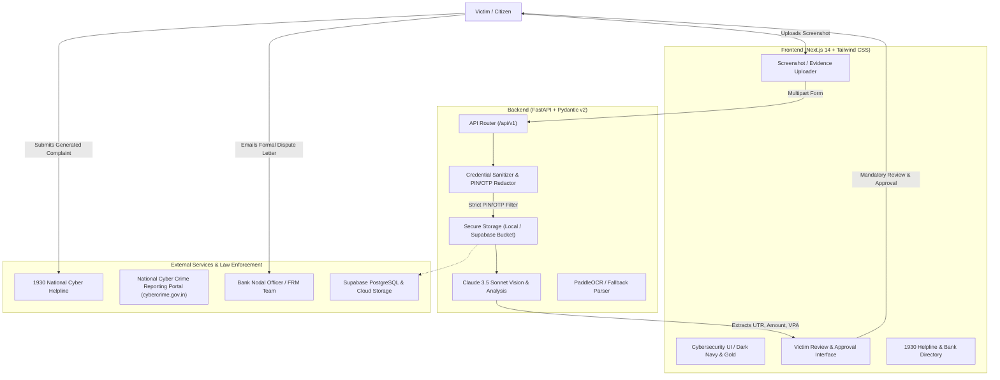

# GoldenHour Architecture Documentation

## 1. Executive Overview
**GoldenHour** is an AI-powered emergency assistance and rapid-reporting platform for victims of Unified Payments Interface (UPI) financial fraud. 

In financial cybercrime, the **Golden Hour (first 2-3 hours)** is the critical operational window during which stolen funds remain in the immediate recipient account before being layered or cashed out. By enabling rapid extraction of 12-digit UTR/Reference numbers and beneficiary VPAs from transaction screenshots, GoldenHour empowers victims to file immediate dispute requests with their bank and lodge complaints with the National Cyber Crime Reporting Portal (1930).

---

## 2. System Architecture

---

## 3. Core Modules & Responsibilities

### 3.1 Security & Zero-Credential Compliance
- **Rule**: GoldenHour NEVER prompts for, extracts, logs, or stores UPI PINs, MPINs, OTPs, CVVs, or internet banking passwords.
- **Implementation**: Regex-based scanners (`backend/app/core/security.py`) and Pydantic validation intercept input. Any accidental PIN/OTP detected in OCR or text is immediately overwritten with `[REDACTED-PIN]` or `[REDACTED-OTP]` prior to storage or display.

### 3.2 Human-in-the-Loop Approval Mandate
- GoldenHour **never** automatically files complaints with law enforcement or requests account freezes on its own.
- All AI-generated drafts are presented to the victim in a draft review state (`REVIEW_PENDING`). The user must inspect, verify the transaction details, and explicitly approve (`APPROVED_BY_USER`) before taking action.

### 3.3 Modular Fallbacks
- For offline hackathon demonstrations, both the AI analysis service and Supabase client include automated mock fallbacks that provide clean sample data without failing when cloud credentials or network access are absent.
